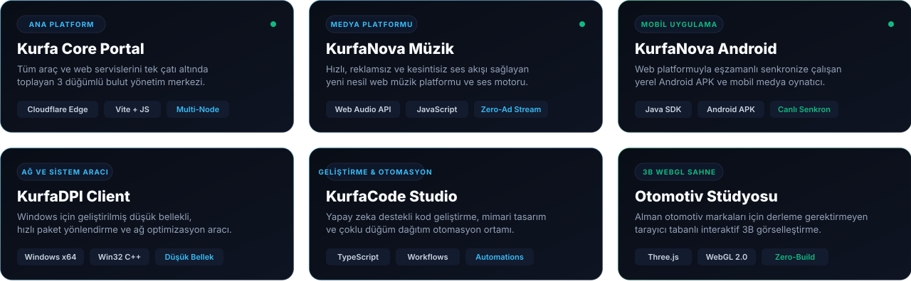
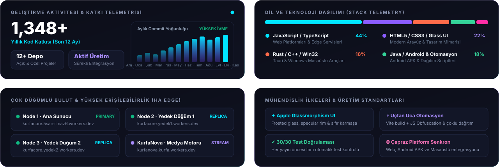

  

  
  
  
  

  

 

## ⚡ Hakkımda & Mühendislik Odakları

Ben **Ozan Sarsılmaz**. **Kurfa Core** markası ve organizasyonu altında; yüksek erişilebilirlikli bulut servisleri, reklamsız medya platformları, mobil uygulamalar ve yerel masaüstü araçlarını uçtan uca tasarlayıp geliştiriyorum.

* 🌐 **Çok Düğümlü Bulut Mimarisi:** Servisler tek bir sunucuya bağlı kalmadan, 3 bağımsız **Cloudflare Worker** düğümü ve **GitHub Pages CDN** üzerinde yüksek erişilebilirlikli (HA) küme olarak çalışır.
* 🎵 **Gerçek Zamanlı Medya Akışı:** **KurfaNova** ile hem web tarayıcılarında hem de senkronize **Android APK** üzerinde sıfır gecikmeli, reklamsız ses deneyimi sunulur.
* ⚡ **Yüksek Performanslı Sistemler:** Rust, C++ ve Windows Win32 API'leri ile doğrudan donanım seviyesinde çalışan yerel masaüstü yazılımları geliştiriyorum.
* 🛡️ **Üretim Seviyesi Otomasyon:** Tüm projeler; optimize edilmiş Vite derleme süreçleri, JS Obfuscation pipeline'ı ve otomatik test kontrolleri ile dağıtılır.

 

## 🚀 Ekosistem & Öne Çıkan Ürünler

  

* 🌐 **[Kurfa Core Platform](https://kurfacore.5sarsilmaz6.workers.dev/)** — 3 düğümlü Cloudflare Workers altyapısıyla çalışan merkezi komuta ve servis yönetim portalı.  
  &nbsp;&nbsp;&nbsp;&nbsp;↳ [Canlı Platformu Aç ↗](https://kurfacore.5sarsilmaz6.workers.dev/)

* 🎵 **[KurfaNova Müzik](https://kurfanova.kurfa.workers.dev/)** — Reklamsız, yıldırım hızında ses motoru ve kesintisiz akış deneyimi sunan yeni nesil müzik platformu.  
  &nbsp;&nbsp;&nbsp;&nbsp;↳ [KurfaNova Web ↗](https://kurfanova.kurfa.workers.dev/) &nbsp;·&nbsp; [GitHub Deposu ↗](https://github.com/KurfaCore/kurfanova)

* 📱 **[KurfaNova Android](https://github.com/KurfaCore/kurfanova-app)** — Web platformuyla canlı senkronize çalışan yerel Java / Android APK medya oynatıcı.  
  &nbsp;&nbsp;&nbsp;&nbsp;↳ [Kaynak Kod &amp; APK ↗](https://github.com/KurfaCore/kurfanova-app)

* ⚡ **KurfaDPI Client** — Windows işletim sistemi için geliştirilmiş düşük bellekli, optimize paket yönlendirme ve ağ optimizasyon istemcisi.  
  &nbsp;&nbsp;&nbsp;&nbsp;↳ `Windows Native (x64)`

* 💻 **[KurfaCode Studio](https://github.com/KurfaCore/KurfaCode)** — Yapay zeka destekli kod geliştirme, mimari tasarım ve otonom çoklu düğüm dağıtım otomasyon ortamı.  
  &nbsp;&nbsp;&nbsp;&nbsp;↳ [GitHub Deposu ↗](https://github.com/KurfaCore/KurfaCode)

* 🏎️ **[Otomotiv Stüdyosu](https://github.com/KurfaCore/alman-otomotiv-studyosu)** — Alman otomotiv markaları için tarayıcıda çalışan, build adımı gerektirmeyen interaktif 3B WebGL sunum sahnesi.  
  &nbsp;&nbsp;&nbsp;&nbsp;↳ [GitHub Deposu ↗](https://github.com/KurfaCore/alman-otomotiv-studyosu)

 

## 📊 Sistem Telemetrisi & Bulut Altyapısı

  

 

## 🛠️ Teknoloji Cephaneliği

  

  <code>TypeScript</code> &nbsp;·&nbsp; 
  <code>JavaScript</code> &nbsp;·&nbsp; 
  <code>React</code> &nbsp;·&nbsp; 
  <code>Rust</code> &nbsp;·&nbsp; 
  <code>Tauri</code> &nbsp;·&nbsp; 
  <code>C++ / Win32</code> &nbsp;·&nbsp; 
  <code>Java / Android</code> &nbsp;·&nbsp; 
  <code>Cloudflare Edge</code> &nbsp;·&nbsp; 
  <code>Three.js</code>

 

---

  <b>Kurfa Core</b> &nbsp;·&nbsp; Sistem Mimarisi &amp; Geliştirme: <b>Ozan Sarsılmaz</b> 
  
    <a href="https://kurfacore.5sarsilmaz6.workers.dev/">Resmi Web Sitesi</a> &nbsp;·&nbsp;
    <a href="https://kurfanova.kurfa.workers.dev/">KurfaNova Müzik</a> &nbsp;·&nbsp;
    <a href="https://www.instagram.com/5o.z.a.n6/">Instagram (@5o.z.a.n6)</a>
  

