  

  <a href="https://kurfacore.5sarsilmaz6.workers.dev/">Website</a>
  &nbsp;·&nbsp;
  <a href="https://kurfanova.kurfa.workers.dev/">KurfaNova</a>
  &nbsp;·&nbsp;
  <a href="https://www.instagram.com/5o.z.a.n6/">Instagram</a>

 

I'm Ozan, an independent developer from Türkiye. Under the **Kurfa Core** name I build and ship my own products end to end — from the interface to the deployment.

I like software that is fast, quiet and easy to live with: clean interfaces, small footprints, and no unnecessary moving parts.

 

### Projects

**[KurfaNova](https://github.com/KurfaCore/kurfanova)** &nbsp;`JavaScript`  
An ad-free music streaming platform for the web. &nbsp;[Live →](https://kurfanova.kurfa.workers.dev/)

**[KurfaNova for Android](https://github.com/KurfaCore/kurfanova-app)** &nbsp;`Java`  
The native Android companion to KurfaNova, with playback that stays in sync with the web.

**[Kurfa Core](https://kurfacore.5sarsilmaz6.workers.dev/)** &nbsp;`Cloudflare Workers`  
The home of the ecosystem, served from the edge across redundant nodes.

**[Automotive Studio](https://github.com/KurfaCore/alman-otomotiv-studyosu)** &nbsp;`three.js`  
An interactive 3D showcase for German car brands — runs straight in the browser, no build step.

**KurfaDPI** &nbsp;`Windows`  
A lightweight network utility for Windows.

 

### Toolbox

  

 

© Kurfa Core

