  

  
  
  
  

  

 

## ⚡ About Me & Engineering Philosophy

I'm **Ozan Sarsılmaz**, an independent software engineer and systems architect from Türkiye, engineering products under the **Kurfa Core** banner.

* 🌐 **Edge-First Cloud Architecture:** Designing resilient web applications distributed across redundant **Cloudflare Workers** edge nodes and global CDNs for sub-second response times and continuous availability.
* 🎵 **Low-Latency Media Streaming:** Building **KurfaNova**, a zero-ad, high-fidelity audio engine featuring real-time playback synchronization between web browsers and native **Android** clients.
* ⚡ **Systems & Native Desktop:** Engineering high-performance, low-memory tools with **Rust**, **C++**, and native **Windows Win32 / DWM** APIs.
* 🛡️ **Zero-Clutter Quality Standard:** Prioritizing clean typography, hardware-accelerated rendering, and automated CI/CD pipelines verified with end-to-end test suites.

 

## 🚀 Featured Ecosystem & Projects

### 🌐 [Kurfa Core Platform](https://kurfacore.5sarsilmaz6.workers.dev/)
> **Central Command & Multi-Node Edge Infrastructure**  
> High-availability edge architecture deployed across a redundant 3-node Cloudflare Workers cluster, providing unified service routing, edge computing, and automatic failover.  
> `Cloudflare Workers` · `Vite` · `High-Availability CDN`  
> ↳ [Open Live Platform ↗](https://kurfacore.5sarsilmaz6.workers.dev/)

 

### 🎵 [KurfaNova Music](https://kurfanova.kurfa.workers.dev/)
> **Ad-Free, High-Fidelity Audio Streaming Platform**  
> Modern streaming audio engine engineered with the Web Audio API, delivering instant playback, custom frequency equalization, zero commercial interruptions, and ultra-low buffering latency.  
> `Web Audio API` · `JavaScript` · `Real-Time Audio Engine`  
> ↳ [Launch Player ↗](https://kurfanova.kurfa.workers.dev/) &nbsp;·&nbsp; [GitHub Repository ↗](https://github.com/KurfaCore/kurfanova)

 

### 📱 [KurfaNova for Android](https://github.com/KurfaCore/kurfanova-app)
> **Synchronized Native Mobile Audio Client**  
> Native Android application that keeps playback state, audio tracks, and user playback controls seamlessly synchronized in real-time with the web player.  
> `Java` · `Android SDK` · `Real-Time State Sync`  
> ↳ [Explore Repository &amp; APK ↗](https://github.com/KurfaCore/kurfanova-app)

 

### ⚡ [KurfaDPI Client](https://github.com/KurfaCore)
> **High-Performance Win32 Network Utility**  
> Lightweight native Windows client engineered for low-memory packet routing, network optimization, and DPI bypass.  
> `Windows x64` · `Win32 C++` · `Low-Footprint`  
> ↳ `Windows Native Desktop`

 

### 💻 [KurfaCode Studio](https://github.com/KurfaCore/KurfaCode)
> **Autonomous Engineering & Multi-Node Deployment Workspace**  
> Specialized development environment combining AI-assisted workflows, production obfuscation pipelines, and automated multi-node cloud deployments.  
> `TypeScript` · `AI Workflows` · `Automated CI/CD`  
> ↳ [View Repository ↗](https://github.com/KurfaCore/KurfaCode)

 

### 🏎️ [3D Automotive Studio](https://github.com/KurfaCore/alman-otomotiv-studyosu)
> **Zero-Build Interactive WebGL Showcase**  
> Interactive 3D presentation environment for German automotive brands, running client-side directly in the browser with zero build steps.  
> `Three.js` · `WebGL 2.0` · `Zero-Build Architecture`  
> ↳ [Explore Repository ↗](https://github.com/KurfaCore/alman-otomotiv-studyosu)

 

## 🛠️ Weapons of Choice & Tech Stack

  

  <code>TypeScript</code> &nbsp;·&nbsp; 
  <code>JavaScript (ES2024)</code> &nbsp;·&nbsp; 
  <code>React</code> &nbsp;·&nbsp; 
  <code>Rust</code> &nbsp;·&nbsp; 
  <code>Tauri</code> &nbsp;·&nbsp; 
  <code>C++ / Win32</code> &nbsp;·&nbsp; 
  <code>Java / Android</code> &nbsp;·&nbsp; 
  <code>Cloudflare Edge</code> &nbsp;·&nbsp; 
  <code>Three.js (WebGL)</code>

 

---

  <b>Kurfa Core</b> &nbsp;·&nbsp; Systems Architecture &amp; Engineering by <b>Ozan Sarsılmaz</b> 
  
    <a href="https://kurfacore.5sarsilmaz6.workers.dev/">Official Website</a> &nbsp;·&nbsp;
    <a href="https://kurfanova.kurfa.workers.dev/">KurfaNova Music</a> &nbsp;·&nbsp;
    <a href="https://kurfacore.github.io/">GitHub Portal</a> &nbsp;·&nbsp;
    <a href="https://www.instagram.com/5o.z.a.n6/">Instagram (@5o.z.a.n6)</a>
  

