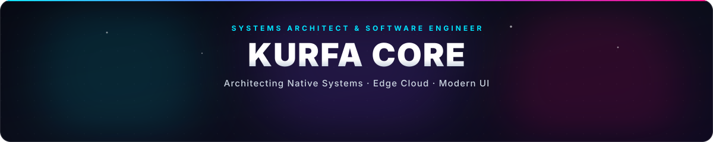
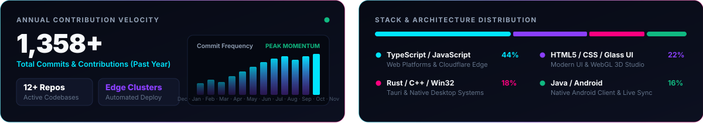

<p align="center">
  
</p>

<p align="center">
  
</p>

<p align="center">
  <a href="https://kurfacore.5sarsilmaz6.workers.dev/">
    
  </a>
  <a href="https://kurfanova.kurfa.workers.dev/">
    
  </a>
  <a href="https://kurfacore.github.io/">
    
  </a>
  <a href="https://www.instagram.com/5o.z.a.n6/">
    
  </a>
</p>

---

### 🚀 About Me & Engineering Focus

Systems architect and software engineer engineering high-performance desktop systems (**Rust & Win32 DWM**), multi-node edge computing (**Cloudflare Workers**) architectures, and clean, high-contrast user interfaces.

* ⚡ **Systems & Native Desktop:** Windows DWM (Desktop Window Manager), DirectComposition transparency layers, and Tauri/Rust native system integrations.
* 🌐 **Edge Computing & Cloud:** Redundant 3-node Cloudflare Workers cluster delivering high availability (HA), zero downtime, and edge routing.
* 🎨 **Design Reflex & Quality:** Zero clutter, hardware-accelerated performance, responsive layout, and seamless user experiences.

---

### 🌟 Featured Projects & Ecosystem

| Project | Category | Description | Link |
| :--- | :---: | :--- | :---: |
| **Kurfa Core** | `Edge Architecture` | Central command & multi-node platform deployed across 3 redundant Cloudflare Workers. | [Live Node](https://kurfacore.5sarsilmaz6.workers.dev/) |
| **KurfaNova** | `Web & Mobile` | Lightning-fast, ad-free music streaming platform with synchronized audio playback. | [Platform](https://kurfanova.kurfa.workers.dev/) |
| **KurfaNova Android** | `Android App` | Native Android mobile application synchronized in real-time with the KurfaNova web player. | [Source Code](https://github.com/KurfaCore/kurfanova-app) |
| **KurfaDPI** | `Networking / Win32` | Ultra-lightweight, high-performance packet routing and network optimization client for Windows. | `KurfaDPI Client` |
| **KurfaCode** | `AI & Automation` | AI-assisted development, obfuscation pipeline, and automated multi-node cloud deployments. | [Source Code](https://github.com/KurfaCore/KurfaCode) |
| **Automotive Studio** | `3D WebGL` | Interactive 3D presentation environment for German car brands, running directly in browser with zero build step. | [Source Code](https://github.com/KurfaCore/alman-otomotiv-studyosu) |

---

### 🛠️ Tech Arsenal

<p align="center">
  <a href="https://skillicons.dev">
    
  </a>
</p>

```text
  Native & Systems   ::  Rust • C++ • Win32 API • Windows DWM • Tauri
  Frontend & UI      ::  TypeScript • React • Tailwind CSS • Vite • Framer Motion
  Edge & Cloud       ::  Cloudflare Workers (HA 3-Node) • Cloudflare Pages • GitHub Pages
  Tools & Toolchain  ::  Git • PowerShell • Bun • Node.js • MSVC Build Tools
```

---

### 📊 GitHub Telemetry

<p align="center">
  
</p>

---

<p align="center">
  <i>"Zero clutter, hardware-accelerated performance, and uncompromising aesthetic engineering."</i>
</p>

<p align="center">
  
</p>
